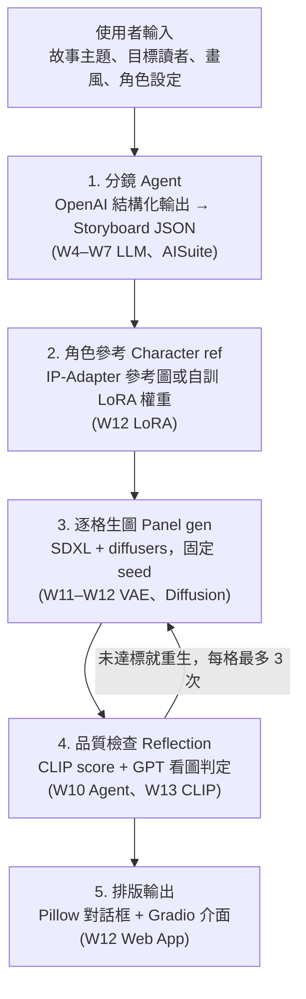

# 繪本生成 Agent 期末專案企畫書

> 生成式 AI：文字與圖像生成的原理與實務 · 2026-10-13 · Joy
> 本檔為企畫書主版本，修改一律在此進行；早期的線上版已停止更新。相關研究調查見 `research_notes.md`。

## 專案摘要

本專案打造一個**繪本生成 Agent（Picture Book Agent）**：使用者輸入一句故事主題，系統自動完成故事分鏡、逐格生圖、品質檢查與排版，輸出 6–8 格、角色外觀前後一致的繪本。

技術核心是 **角色一致性 Character consistency**。專案會比較 Prompt、IP-Adapter、LoRA 三種做法及 LoRA + IP-Adapter 組合（共四組），並用 CLIP／DINOv2 相似度量化效果。專案同時串起課程的文字端（LLM、Agent）與圖像端（Diffusion、CLIP、LoRA），成果以 Gradio Web App 與 3 分鐘 demo 影片呈現。

## 動機與問題

繪本創作需要編劇、分鏡與繪圖三種能力，一般家長或老師很難快速做出客製化的故事，例如把孩子的名字、寵物或當週主題寫進故事裡。

生成式 AI 看似能解決這件事，但直接用文字生圖會遇到三個問題：

- **角色不一致**：同一個角色在每格的髮型、服裝、配色都不一樣，讀者認不出是同一人。這是整個任務最大的障礙。
- **圖文不符**：生成的圖漏掉劇情需要的動作或物件。
- **流程繁瑣**：使用者要自己拆分鏡、寫每格 prompt、挑圖、排版。

本專案把這三個問題分別交給 Agent 的不同模組處理，並對第一個問題做系統化的實驗。

## 相關研究 Related work

| 方向 | 代表方法 | 與本專案的關係 |
| --- | --- | --- |
| 主體驅動生成 Subject-driven | DreamBooth、LoRA | 以少量圖微調記住角色，對應方案 C |
| 免訓練參考圖注入 | IP-Adapter | 用 image embedding 約束外觀，對應方案 B |
| 免訓練一致注意力 | StoryDiffusion、ConsiStory、1Prompt1Story、Story2Board | 修改 attention 讓同批圖共享角色特徵；可外掛於 SDXL，列為彈性方案 E |
| LLM 自我修正 | Self-Refine、Reflexion | 「生成 → 評估 → 修正」迴圈，對應品質檢查模組 |
| VLM 稽核修正 Agent | Audit & Repair（2025） | 用 VLM 描述各格屬性、比對不一致後局部修圖；本專案的 reflection 借用「屬性清單比對」，並以免費指標先篩以降低 API 成本 |
| 故事視覺化 Agent | MM-StoryAgent（2025）、CANVAS（2026） | 多 Agent 分工寫故事、生圖；CANVAS 以角色／場景／道具記憶維持長程連續性。本專案範圍較小，聚焦單一主角並做方法比較 |
| 評測基準 | ViStoryBench（CVPR 2026） | 12 項自動指標，含角色一致性、prompt 對齊與 **copy-paste 偵測**；本專案的指標設計參考它 |

本專案的定位不是提出新模型，而是把現成方法組成可用的 Agent，並在同一套設定下量化比較各方法的取捨。近期研究（ViStoryBench、Story2Board）指出一個常被忽略的問題：一致性分數高，可能只是模型**照抄參考圖的姿勢與構圖**。因此本專案除了一致性與對齊，也量測「多樣性」，避免把照抄誤判成成功。

## 目標與範圍

| 類別 | 內容 |
| --- | --- |
| 必做 Must | 一句主題 → 6–8 格完整繪本；單一主角全程一致；繁體中文台詞；Gradio 介面 |
| 必做 Must | 四組一致性方案（A–D）的量化比較實驗 |
| 加分 Should | Reflection loop 自動重生不合格的格；使用者可上傳角色參考圖 |
| 彈性 Could | 兩個角色同框；單格重生與手動修改台詞；匯出 PDF；方案 E（StoryDiffusion 一致注意力）；商用模型參照組 |
| 不做 Won't | 動畫或影片、語音朗讀、從頭訓練 diffusion 模型、商業上線 |

範圍以「單一主角」為底線，因為多角色同框是一致性最難的情況，放在彈性目標。

## 系統架構

文字端模組（分鏡、品質判定）呼叫 OpenAI API，圖像端模組全部在 Colab GPU 執行；品質檢查未達標的格會退回生圖模組重做。

### 輸入與輸出規格

| 項目 | 內容 |
| --- | --- |
| 輸入 | 故事主題（必填）、目標讀者（預設 3–6 歲）、格數 6–8、畫風偏好、角色設定（選填）、角色參考圖（選填） |
| 中間產物 | `Storyboard` JSON：`title`、`logline`、`art_style`、`characters[]`（`id`／`name`／`appearance`／`personality`）、`panels[]`（`index`／`scene`／`characters`／`shot_type`／`image_prompt`／`dialogue[]`） |
| 每格紀錄 | 最終 SD prompt、negative prompt、seed、scheduler、步數、CFG、一致性方案、各項分數、重試次數 → 存成 `panel_XX.json` 與圖檔並列 |
| 輸出 | 排版後的繪本頁面（PNG，彈性目標為 PDF）與完整 run log |

### 部署與資料流

- 本機（無 NVIDIA GPU）只開發文字端與純 Python 邏輯；需要 GPU 的程式寫成 `notebooks/*.ipynb` 在 Colab 執行。
- Colab 透過 `git clone` GitHub repo 取得 `src/comic_agent`；模型快取、LoRA 權重與生成結果存 Google Drive，斷線後可續跑。

## 技術方法

每個模組都對應到課程的特定週次，整個專案等於把 W4–W13 的內容串成一個系統。

### 1. 分鏡 Agent（W4–W7 LLM、AISuite）

- 用 OpenAI **結構化輸出 Structured Output**，依 pydantic schema 產生 `Storyboard`：角色列表、每格的場景、鏡頭類型、台詞與英文 image prompt。
- **外觀只定義一次**：角色外觀寫在 `Character.appearance`，每格只描述動作，最終 prompt 由程式組合。這是 prompt 層的一致性策略，也是實驗的 baseline。
- 程式層驗證：格數、引用的角色是否存在等 schema 擋不住的邏輯錯誤。
- 磁碟快取：相同輸入不重複呼叫 API。→ **已完成骨架**

### 2. 逐格生圖（W11–W12 VAE、Diffusion、diffusers）

- 在 Colab T4 上以 HuggingFace `diffusers` 執行 SDXL，開發期可先用 SD 1.5 加速。
- 每格固定 seed、記錄 scheduler、步數與 CFG scale，確保實驗可重現。
- 預設設定（實驗中固定）：`stabilityai/stable-diffusion-xl-base-1.0`、fp16、DPM++ 2M Karras、30 步、CFG 6.5、1024×1024；seed 由「故事編號 × 100 + 格數」決定，四種方案共用同一組 seed。
- 開發期的 SD 1.5 只用來驗證流程；IP-Adapter 與 LoRA 權重需與底模相符，**正式實驗一律用 SDXL**。

### 3. 角色一致性（W12 LoRA、W13 CLIP）

| 方案 | 原理 | 優點 | 缺點 |
| --- | --- | --- | --- |
| A. Prompt only | 每格使用相同外觀描述 | 零成本 | 一致性差，作為對照組 |
| B. IP-Adapter | 參考圖的 image embedding 注入 cross-attention | 免訓練，換角色只要換圖 | 臉部細節易跑掉，可能壓過 prompt |
| C. LoRA | 以 10–20 張角色圖微調 | 一致性最好 | 每個角色都要訓練 |
| D. LoRA + IP-Adapter | 兩者疊加 | 預期最穩 | 參數多、難調 |

LoRA 的訓練資料由「方案 B 生成 → 人工挑選」取得，不需要外部資料集。

**實作細節**

- **角色參考圖**：用方案 A 的外觀 prompt 生成正面全身立繪 8 張，人工挑 1 張作為 IP-Adapter 參考圖；使用者上傳參考圖時直接取代。
- **IP-Adapter**：`h94/IP-Adapter` 的 `ip-adapter-plus_sdxl_vit-h`，以 diffusers `load_ip_adapter()` 載入；scale 掃描 0.3／0.5／0.7，在一致性與對齊之間挑一個值用於主實驗。
- **LoRA**：以 diffusers `train_dreambooth_lora_sdxl.py` 訓練；15 張圖（多角度、多表情、多背景）、caption 為「`<trigger> + 動作／場景`」、rank 16、learning rate 1e-4、約 1000 步；T4 上開 fp16、gradient checkpointing、8-bit Adam，預計 1–1.5 小時。推論時以 trigger word 取代外觀描述中的身分部分，服裝配色仍保留。
- **方案 D**：載入 LoRA 後再加 IP-Adapter，IP-Adapter scale 從 B 的最佳值往下調（預期 0.3–0.5），避免雙重約束壓過 prompt。
- **IP-Adapter 選型理由**：InstantID、PuLID、IP-Adapter-FaceID 依賴人臉辨識模型，對動物或卡通角色常偵測不到臉，因此不採用；`plus` 版保留較多服裝與配色細節，較適合繪本角色。
- **參考圖的姿勢外洩**：參考圖的姿勢與構圖容易被照抄，scale 越高越明顯。對策是用中性站姿的參考圖，並在評估中加入多樣性指標來監測。

**彈性方案（時間允許才做）**

- **E. StoryDiffusion 一致注意力**：免訓練、可外掛於 SDXL，以 Consistent Self-Attention 讓同一故事的各格互相參照。可作為「免訓練但不需參考圖」的對照，補足 B 與 C 之間的空白。需要批次生成，T4 記憶體可能不足，先以 768 解析度試跑。
- **商用模型參照組**：以 `gpt-image-1-mini` 加參考圖跑同一份分鏡 30 格（medium 品質約 0.011 美金／張，總計約 0.35 美金），作為「現成商用方案能做到多好」的上限參照。底模不同，因此只做參照，不納入 A–D 的公平比較。

### 4. 品質檢查 Reflection loop（W10 Agent 設計模式）

- **自動指標**：CLIP score 檢查圖文對齊，角色相似度檢查一致性。
- **LLM 看圖**：把圖與分鏡一起交給 GPT 視覺模型，回覆「是否符合劇情」並提出 prompt 修改建議。
- 未達門檻就修改 prompt 或換 seed 重生，每格最多重試 3 次，控制成本。

**判定流程**

1. 先跑免費的自動指標：CLIP score 低於門檻 τ_clip，或主角與參考圖的 DINOv2 相似度低於 τ_id，直接判定不合格，不呼叫 GPT。
2. 自動指標通過才送 GPT 看圖，以結構化輸出回傳 `{pass: bool, issues: [...], revised_prompt: str}`。送出時附上參考圖，以及由 `Character.appearance` 拆成的**屬性清單**（例如 short black bob hair、yellow raincoat、red boots），要求 GPT 逐項勾選是否吻合（參考 Audit & Repair 的屬性比對）。逐項檢查比「整體像不像」更穩定，也能指出具體哪個屬性跑掉。
3. 不合格時：GPT 指出「缺物件或動作」→ 改用 `revised_prompt`；只有「構圖或畫質」問題 → 保留 prompt、換 seed。
4. 3 次都不合格時，取分數最高的一張並標記，交給使用者在介面上單格重生。
5. （彈性）只有單一屬性錯誤時，例如雨衣顏色不對，以 Grounding DINO 的偵測框做遮罩，用 SDXL inpainting 局部修正，不整張重生，以保留已經正確的構圖。

門檻 τ_clip、τ_id 不事先拍定，由 10/28–11/16 的試跑結果決定：取方案 A 分數分布的第 25 百分位，並在報告中列出最終數值。CLIP text encoder 只吃 77 tokens，因此 CLIP score 用該格的 `image_prompt`（場景與動作），不用含畫風與外觀的完整 SD prompt。

### 5. 排版與介面（W12 Web App）

- 用 Pillow 在圖上加對話框與旁白，台詞不交給 diffusion 生成（中文字會生成亂碼）。
- Gradio 介面：輸入主題 → 檢視分鏡 → 生圖 → 單格重生 → 下載。

## 技術選型與成本

文字端使用 OpenAI API，圖像端全部在 Colab 免費 GPU 本地執行，預計總成本不超過課程建議的 5 美金儲值。

| 元件 | 選用 | 執行環境 | 成本 |
| --- | --- | --- | --- |
| 分鏡、看圖檢查 | OpenAI mini 等級模型（可由 `.env` 切換） | API | 使用課程建議的 5 美金 credit |
| 生圖 | SDXL（開發期 SD 1.5）+ `diffusers` | Colab T4 | 免費 |
| 一致性 | IP-Adapter、LoRA（`peft`） | Colab T4 | 免費 |
| 評估 | `open_clip`、DINOv2、DreamSim、Grounding DINO | Colab | 免費 |
| 介面 | Gradio | Colab（`share=True`） | 免費 |
| 程式語言 | Python 3.10+、pydantic | — | — |

**省錢策略**：開發期用便宜的模型，錄 demo 時再換；所有 LLM 回應寫入磁碟快取；reflection 每格最多重試 3 次。必要時輕量子任務可改用課程提供的免費 Groq。

**API 用量估算**（以 `gpt-4.1-mini` 為例，實際單價以 OpenAI 官方價目表為準）

| 用途 | 次數 | 每次約略 tokens | 小計 tokens |
| --- | --- | --- | --- |
| 分鏡（含重跑、調 prompt） | 約 50 | 4k | 0.2M |
| GPT 看圖（實驗 120 張 + 重試 + 開發） | 約 500 | 2.5k（含圖片） | 1.25M |
| 合計 | — | — | 約 1.5M |
| （彈性）商用參照組 `gpt-image-1-mini` | 30 張 | — | 約 0.35 美金 |

估計總花費約 1–1.5 美金，5 美金預算保留足夠餘裕；GPT 只在自動指標通過後才呼叫，是主要的省錢點。

## 評估方法

主實驗回答一個問題：**哪一種方案在「角色一致」與「圖文相符」之間取得最好的平衡？** 兩者通常互相拉扯，參考圖約束越強，prompt 的影響力越弱。

**實驗設計**

- 準備 5 個故事主題 × 每篇 6 格 = 30 格，四種方案（A–D）各生成一次，共 120 張圖。
- 固定 seed、步數、scheduler，只改一致性方案，確保差異來自方案本身。
- 5 個主題刻意涵蓋不同難度：室內／戶外、日／夜、動作幅度大小、主角為人類／動物。定為「小女孩第一次去海邊」「小熊找回遺失的帽子」「男孩在雨天幫助迷路的小貓」「小狐狸第一次自己做生日蛋糕」「女孩夜晚和月亮說話」。原本的「小狐狸的生日派對」需要多個角色同框，超出單一主角的範圍，因此替換。
- 每格最多 2 個角色同框，由 `validate_storyboard` 強制檢查；配角（如故事中的家長）可能未被定義為角色，因此主實驗只量測主角一致性，配角不一致列為限制。
- 分鏡 JSON 先生成並凍結，四種方案共用同一份，避免 LLM 隨機性混入比較。

**研究假設**

- H1：一致性 C、D > B > A。
- H2：B 的圖文對齊低於 A（參考圖壓過 prompt），C 下降較少。
- H3：開啟 reflection 能提升劇情符合率，每格平均 API 花費增加不超過 2 倍。
- H4：B 的 IP-Adapter scale 越高，一致性越高、構圖多樣性越低（copy-paste 傾向）。

**指標實作細節**

- **為何不直接用 ViStoryBench 的角色指標**：它以 ArcFace／AdaFace／FaceNet 人臉特徵計算角色相似度，不適用動物與卡通角色，因此本專案改用 DINOv2（物件層級特徵）加偵測框裁切。偵測加裁切的流程與 ViStoryBench 相同（同樣用 Grounding DINO）。
- **主角區塊裁切**：以 Grounding DINO（或 OWL-ViT）用文字查詢角色類別（如 "girl"、"bear"）偵測主角框，取信心最高者裁切後計算 DINOv2 embedding；偵測失敗的格記為缺值並回報失敗率，不以整張圖代替。
- **角色一致性**同時報告兩種：格與格兩兩相似度（故事內一致）、每格與參考圖相似度（與設定一致）。方案 A 沒有參考圖，以第 1 格作為參考。
- **統計**：每項指標報告平均 ± 標準差，並以故事為單位做 paired 比較（5 篇故事樣本少，以效果量與方向一致性為主，不過度宣稱顯著性）。
- **人工抽查**：每方案隨機抽 30 張中的 8 張（共 32 張），以「角色認得出是同一人／劇情符合」兩題 1–5 分評分，並與 GPT 判定計算一致率，檢驗 GPT 當評審是否可靠。

| 指標 | 量什麼 | 怎麼算 | 方向 |
| --- | --- | --- | --- |
| 角色一致性 | 不同格的主角是否像同一人 | 主角區塊的 DINOv2 embedding 兩兩 cosine similarity 平均；輔以 DreamSim（較貼近人類感知） | 越高越好 |
| 圖文對齊 | 圖是否符合該格劇情 | CLIP score（image_prompt 與圖） | 越高越好 |
| 構圖多樣性 | 是否照抄參考圖或前一格 | 整張圖兩兩 DreamSim 距離平均；並計算每格與參考圖整張的相似度，過高視為 copy-paste | 適中（過低代表照抄） |
| 劇情符合率 | 人眼看是否合理 | GPT 看圖判定 + 人工抽查 32 張 | 越高越好 |
| 生成時間 | 實用性 | 每格平均秒數（T4） | 越低越好 |

**結果呈現**：以「一致性 × 圖文對齊」散佈圖比較四種方案，點的大小代表構圖多樣性，並解讀數字的意義，例如「B 比 A 一致性提升多少、對齊下降多少，代表什麼取捨」，而不是只列出分數。

**Reflection 消融實驗**：比較開啟與關閉 reflection loop 時的劇情符合率與 API 花費，判斷自動重生值不值得。

## 時程規劃

文字端可以現在開始；LoRA 與 CLIP 等圖像端主題在 W11–W13（11/17–12/1）上完後再接上，最後一週保留給錄影片。

| 期間 | 里程碑 | 驗收標準 |
| --- | --- | --- |
| 10/13–10/27 | 分鏡 Agent | 任一主題穩定產出合法 Storyboard JSON |
| 10/28–11/16 | Reflection + SDXL 跑通 | Colab 上一鍵生出 6 格，不合格的格會自動重生 |
| 11/17–12/1 | 角色一致性方案 | 四種方案都能對同一份分鏡生圖 |
| 12/2–12/14 | 一致性實驗與介面 | 120 張圖的指標表 + 解讀；Gradio 可完整操作 |
| 12/15–12/21 | 錄製 demo 影片 | 3 分鐘影片完成並上傳 |
| 12/22 | Gather.town 發表 | — |

**目前進度（2026-10-13）**：分鏡 Agent 骨架完成（schema、結構化輸出、磁碟快取、邏輯驗證），離線測試通過；尚未實際呼叫 API 驗證。

## 風險與對策

| 風險 | 影響 | 對策 |
| --- | --- | --- |
| Colab 免費 GPU 斷線或配額用完 | 實驗中斷、進度延誤 | 模型與 LoRA 權重存 Google Drive；結果逐張寫檔可續跑；必要時訂 Colab Pro 一個月 |
| SDXL 在 T4 VRAM 不足 | 無法生圖或很慢 | fp16 + `enable_model_cpu_offload()`；開發期改用 SD 1.5 |
| 多角色同框一致性差 | 影響故事豐富度 | 底線限定單一主角；多角色列為彈性目標 |
| Diffusion 生成中文字亂碼 | 對話框無法使用 | negative prompt 排除文字，台詞一律由 Pillow 後製 |
| IP-Adapter 壓過 prompt | 動作、場景不符 | 調低 adapter scale，並以評估實驗找最佳值 |
| API 花費超出預期 | 額外成本 | 磁碟快取；reflection 每格最多 3 次；追蹤 token 用量 |
| 版權與倫理 | 評審扣分 | 不模仿既有動漫角色；角色皆為原創；結果標示為 AI 生成 |
| SDXL LoRA 在 T4 訓練過慢或 OOM | 方案 C、D 無法完成 | gradient checkpointing、8-bit Adam、降低解析度至 768；仍不行則改用 SD 1.5 重跑四種方案（換底模但比較仍公平） |
| GPT 當評審不可靠 | 劇情符合率失真 | 人工抽查 32 張並計算與 GPT 的一致率，在報告中揭露 |
| 主角偵測失敗 | 一致性指標缺值或偏差 | 回報偵測失敗率；人工檢查偵測框；必要時改用人工標註框 |
| 兒童向內容安全 | 生成不適當圖像 | 保留 diffusers safety checker；GPT 檢查同時判定內容是否適合目標讀者 |

## 預期成果與展示方式

**交付項目**

- Gradio Web App：輸入一句主題，約數分鐘內產出 6–8 格繪本。
- GitHub repo：程式碼、Colab notebook、README。
- 一致性實驗報告：四種方案的量化比較與解讀。
- 3 分鐘 demo 影片（課程規定不超過 5 分鐘），用於 12/22 Gather.town 發表。

**影片腳本（約 3 分鐘）**

1. 問題（15 秒）：同一個角色在六格裡長得都不一樣的對比圖。
2. 現場 demo（60 秒）：輸入主題 → 分鏡 → 生圖 → reflection 自動修正一格。
3. 技術架構（30 秒）：五個模組與對應的課程內容。
4. 實驗結果（45 秒）：四種方案並列的圖 + 散佈圖解讀。
5. 限制與未來（30 秒）：多角色同框、風格擴充。

**評分考量**：課程規定「一個 prompt 就生得出」的作品分數極低。本專案的辨識度來自三處：多模組 Agent 架構、自訓 LoRA、有量化評估的對照實驗。

## 參考文獻

1. Podell et al. *SDXL: Improving Latent Diffusion Models for High-Resolution Image Synthesis.* 2023.
2. Ye et al. *IP-Adapter: Text Compatible Image Prompt Adapter for Text-to-Image Diffusion Models.* 2023.
3. Hu et al. *LoRA: Low-Rank Adaptation of Large Language Models.* ICLR 2022.
4. Ruiz et al. *DreamBooth: Fine Tuning Text-to-Image Diffusion Models for Subject-Driven Generation.* CVPR 2023.
5. Radford et al. *Learning Transferable Visual Models From Natural Language Supervision (CLIP).* ICML 2021.
6. Hessel et al. *CLIPScore: A Reference-free Evaluation Metric for Image Captioning.* EMNLP 2021.
7. Oquab et al. *DINOv2: Learning Robust Visual Features without Supervision.* 2023.
8. Liu et al. *Grounding DINO: Marrying DINO with Grounded Pre-Training for Open-Set Object Detection.* 2023.
9. Zhou et al. *StoryDiffusion: Consistent Self-Attention for Long-Range Image and Video Generation.* 2024.
10. Tewel et al. *Training-Free Consistent Text-to-Image Generation (ConsiStory).* SIGGRAPH 2024.
11. Madaan et al. *Self-Refine: Iterative Refinement with Self-Feedback.* NeurIPS 2023.
12. Shinn et al. *Reflexion: Language Agents with Verbal Reinforcement Learning.* NeurIPS 2023.
13. Liu et al. *One-Prompt-One-Story: Free-Lunch Consistent Text-to-Image Generation Using a Single Prompt.* ICLR 2025.
14. Dinkevich et al. *Story2Board: A Training-Free Approach for Expressive Storyboard Generation.* 2025.
15. *Audit & Repair: An Agentic Framework for Consistent Story Visualization in Text-to-Image Diffusion Models.* arXiv:2506.18900, 2025.
16. *MM-StoryAgent: Immersive Narrated Storybook Video Generation with a Multi-Agent Paradigm across Text, Image and Audio.* arXiv:2503.05242, 2025.
17. Zhuang et al. *ViStoryBench: Comprehensive Benchmark Suite for Story Visualization.* CVPR 2026.
18. *CANVAS: Continuity-Aware Narratives via Visual Agentic Storyboarding.* arXiv:2604.13452, 2026.
19. Fu et al. *DreamSim: Learning New Dimensions of Human Visual Similarity using Synthetic Data.* NeurIPS 2023.
